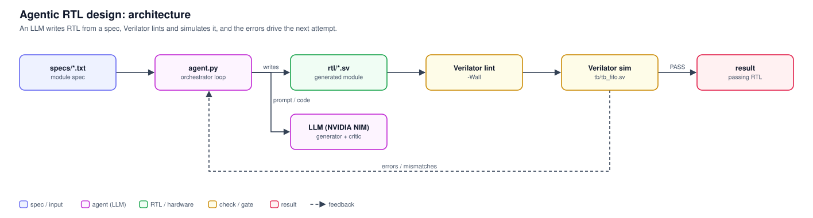
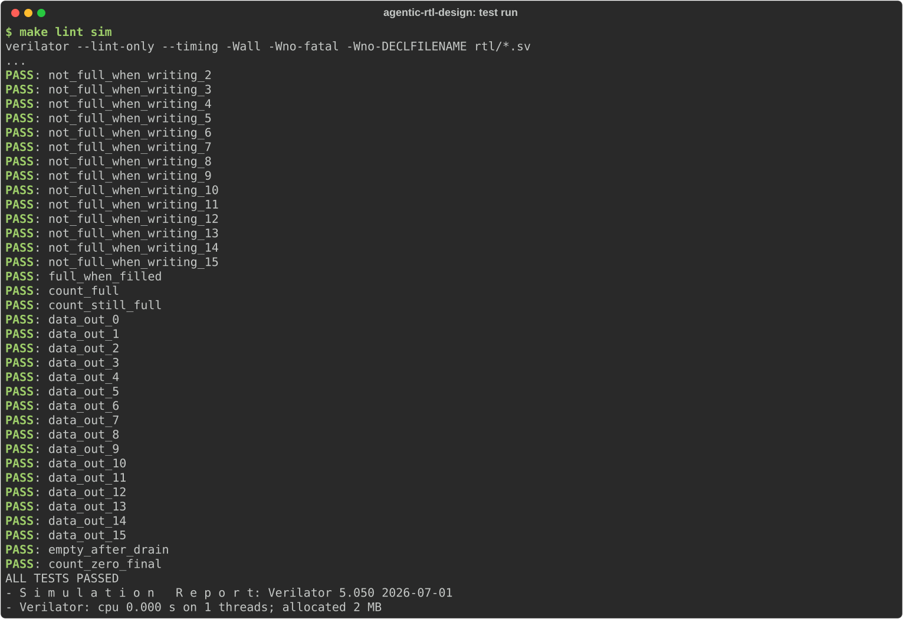

# Agentic RTL Design Framework

[](https://github.com/Ana2601/agentic-rtl-design/actions/workflows/ci.yml)

An AI agent that designs, verifies, and iterates on RTL modules using NVIDIA NIM LLMs and the Verilator tool-loop.

The agent receives a hardware spec, writes Verilog, lints and simulates it with Verilator, reads the errors, fixes them, and repeats until all tests pass — fully local.

## Why this matters

- **LLM-assisted hardware design**: an agent closes the spec -> RTL -> lint/sim -> fix loop on its own
- Demonstrates the full loop: spec -> RTL -> verification -> tool orchestration
- 100% reproducible and runs anywhere

## Architecture



## Components

| File | Purpose |
|---|---|
| `agent.py` | Orchestrator loop: prompt -> LLM -> tools -> iterate |
| `llm.py` | NVIDIA NIM client (OpenAI-compatible) with model selection |
| `tools.py` | Verilator lint/sim tool wrappers + result parsing |
| `prompts.py` | System/user prompt templates for RTL generation |
| `specs/` | Example module specs (e.g., FIFO, UART TX, debouncer) |
| `rtl/` | Generated RTL output |
| `tb/` | Testbench templates |
| `Makefile` | One-command build/test/run |

## Quick start

```bash
export NVIDIA_API_KEY=nvapi-...
pip install -r requirements.txt
make demo            # run agent on the FIFO spec
```

## Configuration

| Env var | Default | Description |
|---|---|---|
| `NVIDIA_API_KEY` | (required) | NVIDIA NIM API key |
| `LLM_MODEL` | `deepseek-ai/deepseek-v4-flash` | Model for RTL generation |
| `LLM_MODEL_CRITIC` | `openai/gpt-oss-20b` | Model for review/critique |
| `MAX_ITER` | 6 | Max self-correction iterations |

## Benchmark table

*Fill in after running:*

| Module | Iterations to pass | Lint errors fixed | Sim time |
|---|---|---|---|
| FIFO | — | — | — |

## Test run

Output of the CI command (`make lint sim`), captured from a local run:



## Setup

- [OSS CAD Suite](https://github.com/YosysHQ/oss-cad-suite-build) (Icarus Verilog, Verilator, Yosys)
- Python packages: `pip install -r requirements.txt`

```bash
make lint
make sim
```

The same commands run in CI on every push (`.github/workflows/ci.yml`).
